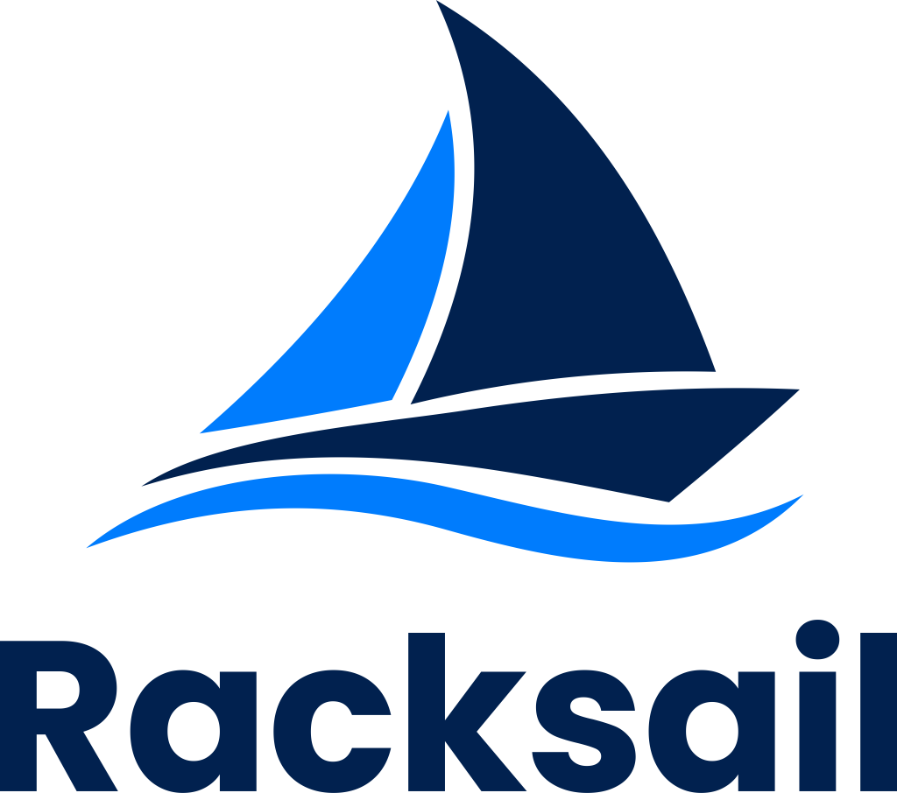

<p align="center">
  
</p>

<p align="center"><strong>Your server, your rules.</strong></p>

Racksail turns a Debian 13 server into a self-hosted platform for websites, email, DNS, apps, file storage, containers and virtual machines. You manage it from one web panel, the `racksail` command and an API. It's free and open source, all of it: no paid tiers, license keys, telemetry, ads or upgrade prompts.

## Status

Racksail is in early development, and there is no release to install yet. The complete feature list for 1.0 is in [docs/architecture/features.md](docs/architecture/features.md).

What runs today is the core: the resource store, the change pipeline, the agent with its typed operations, the module registry with all 22 modules, the API with its OpenAPI document, and the web UI shell. `racksail dev` runs all of it on your own computer against a simulated server.

## What it manages

- **Websites**: PHP, Node, Python, Ruby and static sites, with deploys, staging, per-site rules and automatic HTTPS
- **Email**: mailboxes, aliases, spam filtering, deliverability checks and webmail
- **DNS**: zones, records and DNSSEC, with templates and secondaries
- **Databases**: MariaDB, MySQL, PostgreSQL, Valkey and Memcached
- **Apps**: containers, compose stacks and a catalog of one-click recipes
- **Virtual machines**: VMs and system containers through Incus
- **Storage**: disks, pools, parity arrays, network shares and backups with restic
- **Hosting business**: plans, resellers, white-labelling and billing integration
- **Operations**: monitoring, analytics, automations, migrations from other panels and multiple servers
- **An optional assistant** that works through the same API, with local models or a provider you choose

Each area is a module. Modules ship in the binary but install nothing until you use them.

## Principles

1. **Desired state, not scripts.** Racksail stores what should exist, and the agent keeps the machine matching it.
2. **systemd runs everything.** Sites, workers and scheduled jobs are units, slices, sockets and timers.
3. **The panel can go down; the sites can't.** Nothing a visitor reaches depends on the panel process.
4. **Nothing runs until it's needed.** No software, ports or processes until something needs them.
5. **One change pipeline.** Every change, from any source, is validated, previewed, applied and recorded the same way, and can be undone.
6. **Free and open source, all of it.** Anything that isn't is labelled and never installed by default.
7. **Plain, fast and honest.** Every change is previewed, and every error says what happened and what to do next.

## Development

You need Go 1.27, Node.js 22.22.2 or later with npm (24.15 or later on Node.js 24), git and make, on macOS or Linux. No root and no Debian server are needed: `racksail dev` simulates one.

```sh
git clone https://github.com/vilanobeachflorida/racksail.git
cd racksail
make dev
```

`make dev` starts the panel on http://127.0.0.1:7070 and the UI dev server with hot reload on http://127.0.0.1:5173. Other targets:

| Command | What it does |
|---|---|
| `make check` | What a pull request must pass: formatting, vet, staticcheck, builds for darwin and Linux, Go tests and the UI checks. CI also runs the Go tests with the race detector and builds the docs |
| `make build` | Builds the UI and `bin/racksail` with the UI embedded |
| `make gen` | Regenerates the OpenAPI documents and the UI's generated types and theme |
| `make docs` | Builds the documentation site |

How the code is organized and how to add to it is in [docs/architecture/internals.md](docs/architecture/internals.md). The rest of [docs/architecture/](docs/architecture/) describes how Racksail is built and why.

## Contributing

Contributions are welcome. Read [CONTRIBUTING.md](CONTRIBUTING.md) to get started, and the [code of conduct](CODE_OF_CONDUCT.md). Report security problems privately as described in [SECURITY.md](SECURITY.md). How the project is run is in [GOVERNANCE.md](GOVERNANCE.md).

## License

Racksail is licensed under the [GNU Affero General Public License v3.0 or later](LICENSE). Recipes in the official catalog are licensed under MIT, and the documentation under CC BY 4.0. The name and logo are looked after as described in [GOVERNANCE.md](GOVERNANCE.md).
